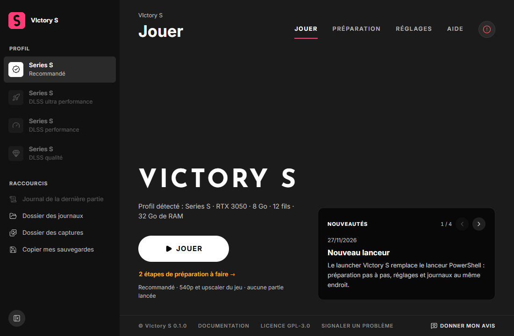
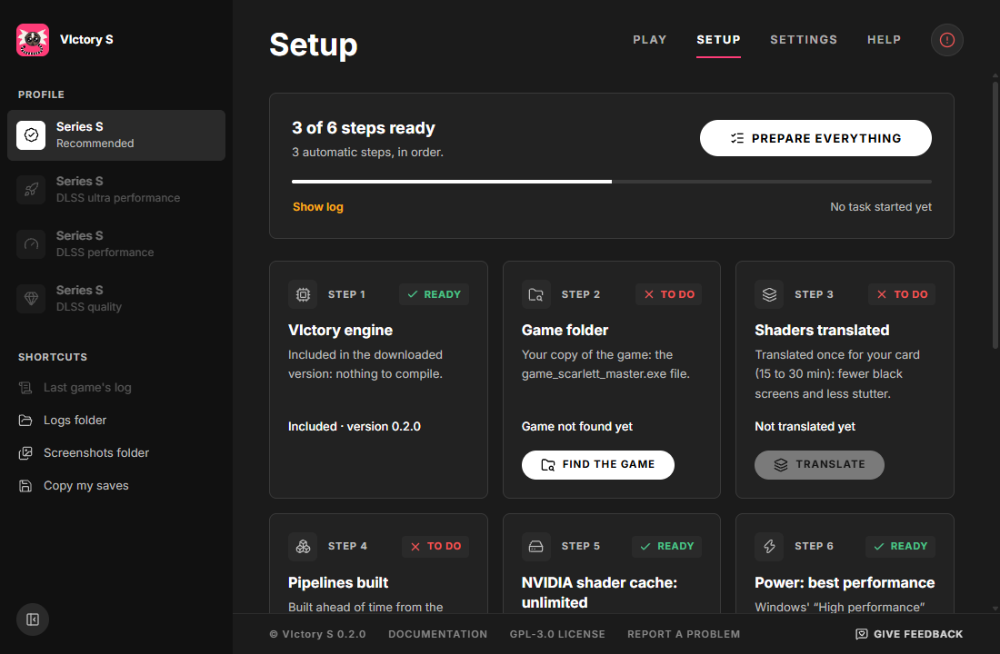
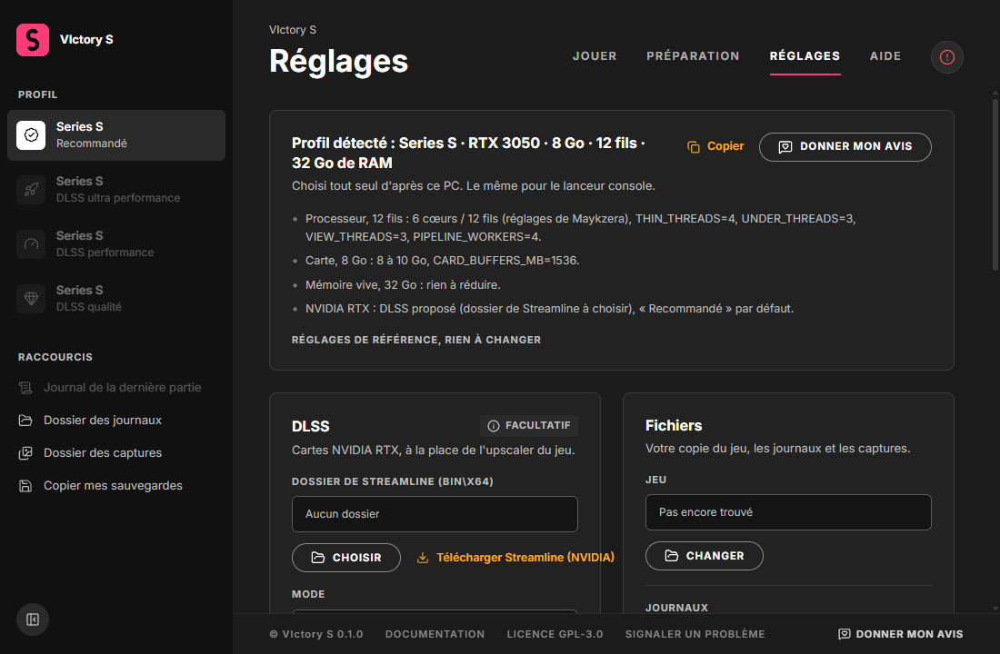
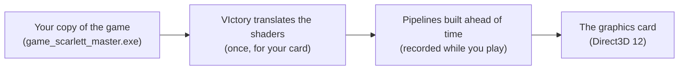

<p align="center">
  
</p>

<p align="center">
  
</p>

<p align="center">
  <b>Your copy of an Xbox Series game on a modest PC, in the Series S profile, tuned for your machine automatically.</b>
</p>

<p align="center">
  <a href="LICENSE"></a>
  
  
  
</p>

<p align="center">
  <a href="https://github.com/sagouindupm/Mandy/releases"></a>
</p>

<p align="center"><sub>One zip, nothing to install or compile. You need your own copy of the game.</sub></p>

---

VIctory S is a version of [VIctory](https://github.com/Marvisak/VIctory) cut out for **low-end PCs**: a 6 to
8 GB graphics card, a 6-core CPU, 16 to 32 GB of RAM. It knows a single profile, the **Xbox Series S** one, and
it comes with a launcher that prepares everything for you.

> [!NOTE]
> **This repository contains no file, code or image from the game**, and neither does the download. You use
> **your own copy**; nothing in it is modified. This project is not affiliated with the game's publisher or
> developer.

## Get started in 3 steps

### 1. Download

Get the latest `VIctory-S-<version>.zip` from the
**[Releases](https://github.com/sagouindupm/Mandy/releases)** page and unzip it wherever you like (not in the
game folder). Double-click **`VIctory S.exe`**.

On first launch, the launcher looks at your PC (CPU, graphics card, RAM) and picks the best profile we can
offer, without asking you anything. You see it under the Play button and, with the reason for each choice, in
**Settings → Detected profile**.

<p align="center"></p>

### 2. Prepare everything

**Setup** tab, **"Prepare everything"** button. The launcher finds the game (`game_scarlett_master.exe` from
your copy), **translates the shaders** for your card, then **builds ahead of time the pipelines** of the shared
list [`series-s/pipelines/series-s-rtx.txt`](series-s/pipelines/series-s-rtx.txt): the 2,874 pipelines the
game uses until after the boat mission, described by hashes only (no game code), built with the shaders of
**your** copy. Only once, about 25 minutes on our machine (18 min of translation, 6 min of building). Each step
has its own status and button, so you can redo it by hand.

You need the **complete copy**: the exe with all its archives next to it (`shaders.rpf`, `levels.rpf` and the
other `.rpf` files, ~130 GB for v1.0.2.1), in its own folder (for example `C:\Games\GTA6`). The exe alone, or a
few loose files in Downloads, are not enough: the launcher says so and tells you what is missing.

<p align="center"></p>

### 3. Play

**Play** tab, **PLAY** button. Since the pipelines are built ahead of time, **the first session is already
smooth**: no stutter or missing drawings until after the boat mission. That is what takes our reference
machine from ~5 to ~10 frames per second. Each session also records the pipelines the list did not have;
**Setup → step 4, "Build"** adds them when you get further into the game.

<p align="center"></p>

> [!TIP]
> **NVIDIA card: set the shader cache to "Unlimited".** NVIDIA Control Panel → Manage 3D settings → Shader
> Cache Size. By default the driver keeps 4 GB per game; once full, every launch recompiles everything and
> feels 1.5 to 2 times slower. The launcher opens the panel for you (step 5).

> [!TIP]
> **PC with 16 GB of RAM:** close your browser, Discord and other programs before playing. The profile adapts
> on its own (part of the game's memory moves to the card; Resizable BAR is required).

> [!WARNING]
> This is a **preview**: expect modest frame rates, picture glitches at times, and crashes. Keep a copy of
> your saves (the launcher's "Copy my saves" shortcut).

## How it works

The console shares a single memory between CPU and graphics card; a PC has two. VIctory loads the game,
imitates the console's system services, translates what the game sends to the card and keeps the two memories
in agreement, frame after frame.



The settings are not guesses: each one was measured (median of several runs at the same place in the game)
and recorded, kept or rejected, in [docs/test-log.md](docs/test-log.md). They are all in
[`series-s/reglages.json`](series-s/reglages.json), with the per-hardware profiles.

## Configs and measured results

Boat mission (chapter I), Series S profile, shaders translated and pipelines built. Nothing is extrapolated:
a row without a measurement is waiting for yours.

| Configuration | Setting | Result |
|---|---|---|
| **RTX 3050 8 GB**, i5-12400F (12 threads), 32 GB, Windows 11 | Recommended: 540p + the game's upscaler, trees shown (current settings) | **97 ms per frame, ~10 fps** |
| RTX 3050 8 GB, same PC | Recommended, without the trees (before they came back, #27) | 84 ms per frame, **11.8 fps** in cutscenes |
| RTX 3050 8 GB, same PC | Boat driven in game, 7 minutes (base of 27 Nov) | **8.6 to 9.9 fps** on the water |
| RTX 3050 8 GB, same PC | DLSS ultra performance (base of 27 Nov) | 90 ms per frame (11.2 fps), clean picture |
| RTX 3050 8 GB, same PC | DLSS performance / quality (base of 27 Nov) | 102 ms / 176 ms per frame |
| GTX 1660 / RTX 2060 6 GB | 6 GB profile | *to measure: help us* |
| RTX 3060 12 GB, RTX 4060 8 GB | 8 GB / 11 GB and more profile | *to measure: help us* |
| RTX 4050 6 GB laptop, 16 GB of RAM | 6 GB, 16 GB profile | *to measure: help us* |
| AMD Radeon RX 6600 / 6700 | Generic Series S profile (untested) | *to measure: help us* |

Picture on the reference machine: realistic water in cutscenes and in game (waves, sun reflections), detailed
faces, Series S interface. The details, and everything that was tried, are in [docs/test-log.md](docs/test-log.md).

### The profile picked for your PC

| What the launcher looks at | What it does with it |
|---|---|
| CPU: 8 threads or fewer / 12 threads / 16 threads or more | 3, 4 or 6 list translation threads (and the helper threads in proportion) |
| Card: 6 GB or less / 8 to 10 GB / 11 GB and more | 768, 1536 or 2048 MB of buffers on the card (never 2048 under 11 GB) |
| RAM: under 24 GB / under 20 GB | game memory partly on the card; under 20 GB, threads one step lower and 1024 MB of buffers at most |
| NVIDIA RTX / other NVIDIA / AMD / Intel | DLSS offered / no DLSS / "untested, generic Series S profile" / dedicated card with 4 GB or more required |

The reference PC keeps exactly the measured settings. Both launchers (graphical and console) do the same
computation, checked by `scripts/check-profils.ps1` and the launcher's tests.

## FAQ

<details>
<summary><b>How many frames per second will I get?</b></summary>

On our reference machine (RTX 3050 8 GB, i5-12400F, 32 GB): about 10 frames per second in the boat mission
(97 ms per frame with the trees; 8.6 to 9.9 fps while driving the boat). On other machines we don't know yet:
that is exactly what your feedback teaches us. The game is not smooth today; the goal is 10-12 fps in
cutscenes and more in game, with a picture faithful to the Series S.
</details>

<details>
<summary><b>It stutters, is that normal?</b></summary>

Not if the setup is done. The game uses thousands of pipelines (the graphics card's programs); "Prepare
everything" translates the shaders (step 3) then builds ahead of time those of the shared list (step 4), until
after the boat mission. If step 4 is not "Ready", run it. Further into the game, new pipelines show up: each
session records them, and "Build" (step 4) adds them. On an NVIDIA card, also set the shader cache to
"Unlimited".
</details>

<details>
<summary><b>AZERTY keyboard, mouse, controller?</b></summary>

An XInput controller (Xbox controller) is recognised; without one, the keyboard acts as a fallback controller
(Enter = A, Backspace = B, Space = X, arrows = D-pad). Mouse: click in the game window to capture it, **Alt** or
**Esc** releases it. **AZERTY** keyboard: keys at the same place as in QWERTY (ZQSD) come with
[PR #29](https://github.com/sagouindupm/Mandy/pull/29); meanwhile, if movement does not respond, switch Windows
to QWERTY while you play (Windows + Space) or use a controller.
</details>

<details>
<summary><b>DLSS?</b></summary>

On **NVIDIA RTX** cards only. You need NVIDIA's Streamline DLLs (sl.interposer.dll, sl.common.dll,
sl.dlss.dll, nvngx_dlss.dll), which you download yourself from
[NVIDIA-RTX/Streamline](https://github.com/NVIDIA-RTX/Streamline/releases): they are not shipped here (NVIDIA
license). Set their folder in Settings → DLSS; the DLSS profiles then become available in the left column. By
default the launcher stays on "Recommended" (540p and the game's upscaler).
</details>

<details>
<summary><b>I have 16 GB of RAM.</b></summary>

The profile sees it and adapts: part of the game's memory moves into the card's (Resizable BAR is required,
enabled in the BIOS: "Above 4G Decoding", "Re-Size BAR"), fewer helper threads, fewer buffers. Close your
browser and Discord before playing, and let Windows manage virtual memory (a small fixed size makes the game
crash, error 0x8007000E).
</details>

<details>
<summary><b>AMD card? Intel integrated graphics?</b></summary>

**AMD**: untested here. The launcher applies the generic Series S profile (without the NVIDIA-specific
settings) and tells you so. Your measurements interest us a lot. **Integrated graphics** (Intel UHD, Iris): not
enough, you need a dedicated graphics card with 4 GB or more.
</details>

<details>
<summary><b>The launcher says "Incomplete game copy" or "Only … shaders translated".</b></summary>

VIctory needs your whole copy of the game, not just `game_scarlett_master.exe`: its archives must sit next to
it (`shaders.rpf`, `levels.rpf` and a dozen other `.rpf` files, ~130 GB for v1.0.2.1). The message says what is
missing. Put the entire copy in its own folder (for example `C:\Games\GTA6`), then Setup → step 2. A complete
copy gives ~25,000 translated shaders; a few hundred means archives are missing: fix step 2, then
"Retranslate".
</details>

<details>
<summary><b>The launcher says "CPU without AVX2".</b></summary>

The download is compiled for CPUs with AVX2 (Intel 4th generation, AMD Ryzen and newer). On an older CPU,
compile VIctory from source (see below).
</details>

## Give feedback

The most useful thing for the project: **tell us how it runs on your PC.** In the launcher, the **"Give
feedback"** button (Help tab or bottom of the window) opens the
[feedback form](https://github.com/sagouindupm/Mandy/issues/new?template=feedback.yml) already filled in with
your configuration and the detected profile. You add your impressions (frames per second, stutter, picture
glitches, screenshots) and send it yourself.

<p align="center"></p>

A crash or a specific bug: [open an issue](https://github.com/sagouindupm/Mandy/issues) with the session log
(Settings → Logs).

## For developers

<details>
<summary><b>Build from source</b></summary>

You need the Rust toolchain from `rust-toolchain.toml`, the Microsoft C++ tools (MSVC) and the Windows SDK, and
Node.js for the launcher.

```powershell
cargo build --release --locked -p victory          # the engine: target\release\victory.exe
cd launcher; npm ci; npm run tauri build -- --no-bundle   # the launcher
```

Or double-click `series-s\Sagouindupm-Launcher.bat`, which installs what is missing (winget) and builds the
launcher; from a repository checkout, step 1 of the launcher compiles the engine.

The download is made with `scripts\package-release.ps1` (engine and launcher for any x86-64 CPU with AVX2, no
Visual C++ runtime to install; content check, zip in `dist\`). A `v<version>` tag publishes it to the Releases
(`.github/workflows/release.yml`).
</details>

<details>
<summary><b>The console launcher</b></summary>

`series-s\Sagouindupm.bat`: a menu in a console (prepare the shaders, play, build the pipelines, DLSS, saves).
It reads the same settings (`series-s\reglages.json`, applied by `series-s\reglages.ps1`), computes the same
profile and shares the graphical launcher's configuration (`%LOCALAPPDATA%\Sagouindupm`). The first time:
**[2]** (translates the shaders and keeps along the way those named by the shared list), **[3]** (imports the
list and builds its pipelines, before playing), then **[1]**.
</details>

<details>
<summary><b>The shared pipeline list</b></summary>

[`series-s/pipelines/series-s-rtx.txt`](series-s/pipelines/series-s-rtx.txt) describes the pipelines the game
uses until after the boat mission: keys, BLAKE3 hashes of the shaders, graphics states; never any game code. By
hand, with the same variables as the launcher:

```powershell
victory pipelines import series-s\pipelines\series-s-rtx.txt --shaders <your shaders>   # or before "victory shaders"
victory warm --used
```

`victory pipelines export <file> --used` writes the list from your own sessions, `victory pipelines merge
<output> <lists...>` combines several (format described in `crates/victory-gpu/src/pipeline/known/list.rs`).
</details>

- **AI assistants**: read [AGENTS.md](AGENTS.md) (the project, its rules, the code map, how to measure).
- **Measurements and leads**: [docs/test-log.md](docs/test-log.md); before trying an idea, check whether it is
  already there.
- **Contributing**: [CONTRIBUTING.md](CONTRIBUTING.md). Nobody pushes directly to `main`: everything goes
  through a pull request.
- **Rule no. 1**: nothing from the game in the repository ([docs/asset-policy.md](docs/asset-policy.md),
  checked by `cargo xtask policy`).

## Credits

- **[VIctory](https://github.com/Marvisak/VIctory)** by Marvisak and its contributors: the basis of everything.
- **[fxceless/victory-fork](https://github.com/fxceless/victory-fork)**, **[avatarmanz/VIctory-7900XTX](https://github.com/avatarmanz/VIctory-7900XTX)**
  (fast architecture: threads, write relay, copies on the card), **[trustno1-coder/VIctory-NVIDIA](https://github.com/trustno1-coder/VIctory-NVIDIA)**
  (NVIDIA, Series S interface, faces, mouse), **[Maykzera/victory-rtx3060](https://github.com/Maykzera/victory-rtx3060)**
  (6-core settings, shader cache valid on NVIDIA, scripted keys). Their README is kept in
  [docs/README-victory-nvidia-rtx3060.md](docs/README-victory-nvidia-rtx3060.md) with the full list of
  their sources.
- **[Proudnoob4/VIctory-NVIDIA](https://github.com/Proudnoob4/VIctory-NVIDIA)** (`nvidia-hybrid-v2`: the
  submitting thread at 52-63 ms instead of 92-116), **[readmet3xt-lab/foxhound](https://github.com/readmet3xt-lab/foxhound)**
  (the heat haze left out).
- **[WASDeKeys/victory-low-end-pc](https://github.com/WASDeKeys/victory-low-end-pc)**, **[stellarr-studio/kelvaroq](https://github.com/stellarr-studio/kelvaroq)**
  (patches, including mesh draws launched by the card): measurements and methods for small cards.
- Developed with the help of [Claude Code](https://claude.com/claude-code).

## Contributors

| Who | Contribution |
|---|---|
| [@sagouindupm](https://github.com/sagouindupm) | maintainer |
| [@Xiaoxi2021](https://github.com/Xiaoxi2021) | RTX 5070 measurements (#9) |
| [@lucid29a](https://github.com/lucid29a) | RTX 4070 Laptop measurements (#10) |
| [@Tejvardhan-717](https://github.com/Tejvardhan-717) | descriptor heap lock (#13, #15) |
| [@Liovera](https://github.com/Liovera) | RTX 4050 Laptop 16 GB measurements (#14) |
| [@LuizFernandoMoretto](https://github.com/LuizFernandoMoretto) | repository policy, test report (#16) |

## License

GPL-3.0-or-later (see [LICENSE](LICENSE)). No GPL-2.0-only code (XCL for example): the loader module that
derived from it is removed and replaced by our own emulation of the AMD instructions.
