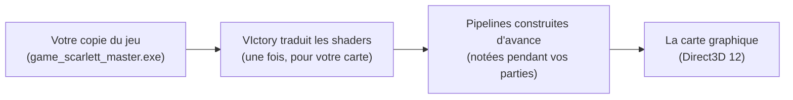
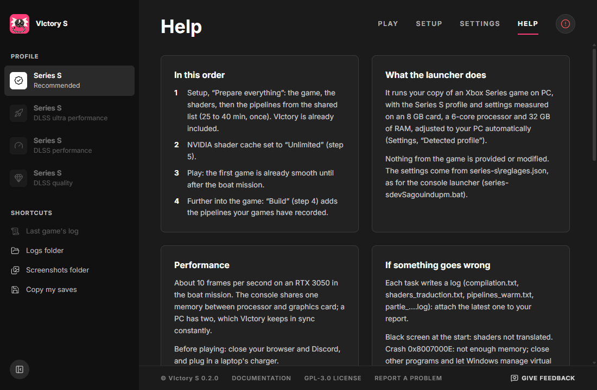

<p align="center">
  
</p>

<p align="center">
  <b>Votre copie d'un jeu Xbox Series sur un PC modeste, en profil Series S, réglée toute seule pour votre machine.</b>
</p>

<p align="center">
  <a href="LICENSE"></a>
  
  
  
</p>

<p align="center">
  <a href="https://github.com/sagouindupm/Mandy/releases"></a>
</p>

<p align="center"><sub>Un zip, rien à installer ni à compiler. Il vous faut votre propre copie du jeu.</sub></p>

---

VIctory S est une version de [VIctory](https://github.com/Marvisak/VIctory) taillée pour les **petites
configurations** : une carte graphique de 6 à 8 Go, un processeur 6 cœurs, 16 à 32 Go de mémoire vive. Elle ne
connaît qu'un profil, celui de la **Xbox Series S**, et elle vient avec un lanceur qui prépare tout pour vous.

> [!NOTE]
> **Ce dépôt ne contient aucun fichier, code ou image du jeu**, et la version téléchargeable non plus. Vous
> utilisez **votre propre copie** ; rien n'y est modifié. Projet sans lien avec l'éditeur ou le développeur du jeu.

## Démarrage en 3 étapes

### 1. Télécharger

Prenez le dernier `VIctory-S-<version>.zip` sur la page des
**[Releases](https://github.com/sagouindupm/Mandy/releases)** et décompressez-le où vous voulez (pas dans le
dossier du jeu). Double-cliquez sur **`VIctory S.exe`**.

Au premier lancement, le lanceur regarde votre PC (processeur, carte graphique, mémoire vive) et choisit le
meilleur profil qu'on sait proposer, sans rien vous demander. Vous le voyez sous le bouton Jouer et, avec les
raisons de chaque choix, dans **Réglages → Profil détecté**.

<p align="center"></p>

### 2. Tout préparer

Onglet **Préparation**, bouton **« Tout préparer »**. Le lanceur trouve le jeu (`game_scarlett_master.exe` de
votre copie), **traduit les shaders** pour votre carte puis **construit d'avance les pipelines** de la liste
partagée [`series-s/pipelines/series-s-rtx.txt`](series-s/pipelines/series-s-rtx.txt) : les 2 874 pipelines
dont le jeu se sert jusqu'après la mission du bateau, décrites par des empreintes seulement (aucun code du jeu),
construites avec les shaders de **votre** copie. Une seule fois, environ 25 minutes sur notre machine (18 min de
traduction, 6 min de construction). Chaque étape a son état et son bouton, pour la refaire à la main.

Il faut la **copie complète** : l'exe avec toutes ses archives à côté (`shaders.rpf`, `levels.rpf` et les
autres `.rpf`, ~130 Go pour la v1.0.2.1), dans son propre dossier (par exemple `C:\Jeux\GTA6`). L'exe seul, ou
quelques fichiers en vrac dans Téléchargements, ne suffisent pas : le lanceur le dit et indique ce qui manque.

<p align="center"></p>

### 3. Jouer

Onglet **Jouer**, bouton **JOUER**. Les pipelines étant construites d'avance, **la première partie est déjà
fluide** : sans à-coups ni dessins manquants jusqu'après la mission du bateau. C'est ce qui fait passer de ~5 à
~10 images par seconde sur notre machine de référence. Chaque partie note aussi les pipelines que la liste
n'avait pas ; **Préparation → étape 4, « Construire »** les ajoute quand vous allez plus loin dans le jeu.

<p align="center"></p>

> [!TIP]
> **Carte NVIDIA : réglez le cache de shaders sur « Illimitée ».** Panneau de configuration NVIDIA → Gérer les
> paramètres 3D → Taille du cache des shaders. Par défaut le pilote garde 4 Go par jeu ; une fois plein, chaque
> lancement recompile tout et paraît 1,5 à 2 fois plus lent. Le lanceur ouvre le panneau pour vous (étape 5).

> [!TIP]
> **PC de 16 Go de mémoire vive :** fermez le navigateur, Discord et les autres programmes avant de jouer. Le
> profil s'adapte tout seul (une partie de la mémoire du jeu passe dans la carte, il faut le Resizable BAR).

> [!WARNING]
> C'est un **aperçu** : attendez-vous à des images par seconde modestes, à des défauts d'image par moments et à
> des plantages. Gardez une copie de vos sauvegardes (raccourci « Copier mes sauvegardes » du lanceur).

## Comment ça marche

La console partage une seule mémoire entre processeur et carte graphique ; un PC en a deux. VIctory charge le
jeu, imite les services du système de la console, traduit ce que le jeu envoie à la carte et garde les deux
mémoires d'accord, image après image.



Les réglages ne sont pas devinés : chacun a été mesuré (médiane de plusieurs passages au même endroit du jeu)
et noté, gardé ou rejeté, dans [docs/essais.md](docs/essais.md). Ils sont tous dans
[`series-s/reglages.json`](series-s/reglages.json), avec les profils par matériel.

## Configs et résultats mesurés

Mission du bateau (chapitre I), profil Series S, shaders traduits et pipelines construites. Rien n'est
extrapolé : une ligne sans mesure attend la vôtre.

| Configuration | Réglage | Résultat |
|---|---|---|
| **RTX 3050 8 Go**, i5-12400F (12 fils), 32 Go, Windows 11 | Recommandé : 540p + upscaler du jeu, arbres affichés (réglages actuels) | **97 ms par image, ~10 fps** |
| RTX 3050 8 Go, même PC | Recommandé, sans les arbres (avant leur retour, #27) | 84 ms par image, **11,8 fps** en cinématique |
| RTX 3050 8 Go, même PC | Bateau piloté en jeu, 7 minutes (base du 27/11) | **8,6 à 9,9 fps** sur l'eau |
| RTX 3050 8 Go, même PC | DLSS ultra performance (base du 27/11) | 90 ms par image (11,2 fps), image propre |
| RTX 3050 8 Go, même PC | DLSS performance / qualité (base du 27/11) | 102 ms / 176 ms par image |
| GTX 1660 / RTX 2060 6 Go | Profil 6 Go | *à mesurer : aidez-nous* |
| RTX 3060 12 Go, RTX 4060 8 Go | Profil 8 Go / 11 Go et plus | *à mesurer : aidez-nous* |
| Portable RTX 4050 6 Go, 16 Go de RAM | Profil 6 Go, 16 Go | *à mesurer : aidez-nous* |
| AMD Radeon RX 6600 / 6700 | Profil Series S générique (non testé) | *à mesurer : aidez-nous* |

Image sur la machine de référence : eau réaliste en cinématique et en jeu (vagues, reflets du soleil), visages
détaillés, interface Series S. Le détail, et tout ce qui a été essayé, est dans [docs/essais.md](docs/essais.md).

### Le profil choisi pour votre PC

| Ce que le lanceur regarde | Ce qu'il en fait |
|---|---|
| Processeur : 8 fils ou moins / 12 fils / 16 fils ou plus | 3, 4 ou 6 fils de traduction des listes (et les fils auxiliaires en proportion) |
| Carte : 6 Go ou moins / 8 à 10 Go / 11 Go et plus | 768, 1536 ou 2048 Mo de tampons sur la carte (jamais 2048 sous 11 Go) |
| Mémoire vive : moins de 24 Go / moins de 20 Go | mémoire du jeu en partie dans la carte ; sous 20 Go, fils un cran plus bas et 1024 Mo de tampons au plus |
| NVIDIA RTX / autre NVIDIA / AMD / Intel | DLSS proposé / pas de DLSS / « non testé, profil Series S générique » / carte dédiée de 4 Go ou plus nécessaire |

Le PC de référence garde exactement les réglages mesurés. Les deux lanceurs (graphique et console) font le même
calcul, vérifié par `scripts/check-profils.ps1` et les tests du lanceur.

## Questions fréquentes

<details>
<summary><b>Combien d'images par seconde vais-je avoir ?</b></summary>

Sur notre machine de référence (RTX 3050 8 Go, i5-12400F, 32 Go) : environ 10 images par seconde dans la
mission du bateau (97 ms par image avec les arbres ; 8,6 à 9,9 fps en pilotant le bateau). Sur d'autres machines, on ne sait pas encore : c'est exactement ce
que vos retours nous apprennent. Le jeu n'est pas fluide aujourd'hui ; l'objectif est 10-12 fps en cinématique
et plus en jeu, avec une image fidèle à la Series S.
</details>

<details>
<summary><b>Ça saccade, c'est normal ?</b></summary>

Pas si la préparation est faite. Le jeu se sert de milliers de pipelines (les programmes de la carte graphique) ;
« Tout préparer » traduit les shaders (étape 3) puis construit d'avance celles de la liste partagée (étape 4),
jusqu'après la mission du bateau. Si l'étape 4 n'est pas « Prêt », lancez-la. Plus loin dans le jeu, de nouvelles
pipelines apparaissent : chaque partie les note, et « Construire » (étape 4) les ajoute. Sur une carte NVIDIA,
réglez aussi le cache de shaders sur « Illimitée ».
</details>

<details>
<summary><b>Clavier AZERTY, souris, manette ?</b></summary>

Une manette compatible XInput (manette Xbox) est reconnue ; sans manette, le clavier en fait une de secours
(Entrée = A, Retour arrière = B, Espace = X, flèches = croix directionnelle). Souris : cliquez dans la fenêtre du
jeu pour la capturer, **Alt** ou **Échap** la libère. Clavier **AZERTY** : les touches à la même place qu'en
QWERTY (ZQSD) arrivent avec la [PR #29](https://github.com/sagouindupm/Mandy/pull/29) ; en attendant, si les
déplacements ne répondent pas, passez Windows en QWERTY le temps de jouer (Windows + Espace) ou prenez une
manette.
</details>

<details>
<summary><b>DLSS ?</b></summary>

Sur les cartes **NVIDIA RTX** seulement. Il faut les DLL de Streamline de NVIDIA (sl.interposer.dll,
sl.common.dll, sl.dlss.dll, nvngx_dlss.dll), à télécharger vous-même depuis
[NVIDIA-RTX/Streamline](https://github.com/NVIDIA-RTX/Streamline/releases) : elles ne sont pas fournies ici
(licence NVIDIA). Indiquez leur dossier dans Réglages → DLSS ; les profils DLSS s'activent alors dans la colonne de
gauche. Par défaut le lanceur reste sur « Recommandé » (540p et l'upscaler du jeu).
</details>

<details>
<summary><b>J'ai 16 Go de mémoire vive.</b></summary>

Le profil le voit et s'adapte : une partie de la mémoire du jeu passe dans celle de la carte (il faut le
Resizable BAR, à activer dans le BIOS : « Above 4G Decoding », « Re-Size BAR »), moins de fils auxiliaires, moins
de tampons. Fermez le navigateur et Discord avant de jouer, et laissez Windows gérer la mémoire virtuelle (une
petite taille fixe fait planter le jeu, erreur 0x8007000E).
</details>

<details>
<summary><b>Carte AMD ? Puce Intel intégrée ?</b></summary>

**AMD** : non testé ici. Le lanceur applique le profil Series S générique (sans les réglages propres à NVIDIA) et
vous le signale. Vos mesures nous intéressent beaucoup. **Puce graphique intégrée** (Intel UHD, Iris) : elle ne
suffit pas, il faut une carte graphique dédiée de 4 Go ou plus.
</details>

<details>
<summary><b>Le lanceur dit « Copie du jeu incomplète » ou « Seulement … shaders traduits ».</b></summary>

VIctory a besoin de toute votre copie du jeu, pas seulement de `game_scarlett_master.exe` : à côté de lui
doivent se trouver ses archives (`shaders.rpf`, `levels.rpf` et une dizaine d'autres `.rpf`, ~130 Go pour la
v1.0.2.1). Le message dit ce qui manque. Rangez la copie entière dans son propre dossier (par exemple
`C:\Jeux\GTA6`), puis Préparation → étape 2. Une copie complète donne ~25 000 shaders traduits ; quelques
centaines veulent dire qu'il manque des archives : corrigez l'étape 2, puis « Retraduire ».
</details>

<details>
<summary><b>Le lanceur dit « Processeur sans AVX2 ».</b></summary>

La version téléchargeable est compilée pour les processeurs avec AVX2 (Intel 4e génération, AMD Ryzen et plus
récents). Sur un processeur plus ancien, compilez VIctory depuis les sources (voir plus bas).
</details>

## Donner mon avis

Le plus utile pour le projet : **dites-nous comment ça tourne chez vous.** Dans le lanceur, bouton
**« Donner mon avis »** (onglet Aide ou bas de la fenêtre) : il ouvre le
[formulaire de retour](https://github.com/sagouindupm/Mandy/issues/new?template=retour-experience.yml) déjà
rempli avec votre configuration et le profil détecté. Vous ajoutez vos impressions (images par seconde,
saccades, défauts d'image, captures) et vous l'envoyez vous-même.

<p align="center"></p>

Un plantage ou un bug précis : [ouvrez un ticket](https://github.com/sagouindupm/Mandy/issues) avec le journal
de la partie (Réglages → Journaux).

## Pour les développeurs

<details>
<summary><b>Compiler depuis les sources</b></summary>

Il faut la chaîne Rust de `rust-toolchain.toml`, les outils C++ de Microsoft (MSVC) et le Windows SDK, et
Node.js pour le lanceur.

```powershell
cargo build --release --locked -p victory          # le moteur : target\release\victory.exe
cd launcher; npm ci; npm run tauri build -- --no-bundle   # le lanceur
```

Ou double-cliquez sur `series-s\Sagouindupm-Launcher.bat`, qui installe ce qui manque (winget) et construit
le lanceur ; depuis un dépôt, l'étape 1 du lanceur compile le moteur.

La version téléchargeable se fabrique avec `scripts\package-release.ps1` (moteur et lanceur pour tout processeur
x86-64 avec AVX2, sans runtime Visual C++ à installer ; vérification du contenu, zip dans `dist\`). Un tag
`v<version>` la publie dans les Releases (`.github/workflows/release.yml`).
</details>

<details>
<summary><b>Le lanceur console</b></summary>

`series-s\Sagouindupm.bat` : un menu dans une console (préparer les shaders, jouer, construire les pipelines,
DLSS, sauvegardes). Il lit les mêmes réglages (`series-s\reglages.json`, appliqués par `series-s\reglages.ps1`),
calcule le même profil et partage la configuration du lanceur graphique (`%LOCALAPPDATA%\Sagouindupm`).
La première fois : **[2]** (traduit les shaders et garde au passage ceux que nomme la liste partagée), **[3]**
(importe la liste et construit ses pipelines, avant de jouer), puis **[1]**.
</details>

<details>
<summary><b>La liste de pipelines partagée</b></summary>

[`series-s/pipelines/series-s-rtx.txt`](series-s/pipelines/series-s-rtx.txt) décrit les pipelines dont le jeu
se sert jusqu'après la mission du bateau : clés, empreintes BLAKE3 des shaders, états graphiques ; jamais de
code du jeu. À la main, avec les mêmes variables que le lanceur :

```powershell
victory pipelines import series-s\pipelines\series-s-rtx.txt --shaders <vos shaders>   # ou avant « victory shaders »
victory warm --used
```

`victory pipelines export <fichier> --used` écrit la liste de vos propres parties, `victory pipelines merge
<sortie> <listes...>` en réunit plusieurs (format décrit dans `crates/victory-gpu/src/pipeline/known/list.rs`).
</details>

- **Assistants IA** : lisez [AGENTS.md](AGENTS.md) (le projet, ses règles, la carte du code, comment mesurer).
- **Mesures et pistes** : [docs/essais.md](docs/essais.md) ; avant d'essayer une idée, regardez si elle n'y est
  pas déjà.
- **Contribuer** : [CONTRIBUTING.md](CONTRIBUTING.md). Personne ne pousse directement sur `main` : tout passe par
  une pull request.
- **Règle n° 1** : rien du jeu dans le dépôt ([docs/asset-policy.md](docs/asset-policy.md), vérifié par
  `cargo xtask policy`).

## Crédits

- **[VIctory](https://github.com/Marvisak/VIctory)** de Marvisak et ses contributeurs : la base de tout.
- **[fxceless/victory-fork](https://github.com/fxceless/victory-fork)**, **[avatarmanz/VIctory-7900XTX](https://github.com/avatarmanz/VIctory-7900XTX)**
  (architecture rapide : fils, relais d'écriture, copies sur la carte), **[trustno1-coder/VIctory-NVIDIA](https://github.com/trustno1-coder/VIctory-NVIDIA)**
  (NVIDIA, interface Series S, visages, souris), **[Maykzera/victory-rtx3060](https://github.com/Maykzera/victory-rtx3060)**
  (réglages 6 cœurs, cache de shaders valable sur NVIDIA, touches scriptées). Leur README est conservé dans
  [docs/README-victory-nvidia-rtx3060.md](docs/README-victory-nvidia-rtx3060.md) avec la liste complète de
  leurs sources.
- **[Proudnoob4/VIctory-NVIDIA](https://github.com/Proudnoob4/VIctory-NVIDIA)** (`nvidia-hybrid-v2` : le fil de
  soumission à 52-63 ms au lieu de 92-116), **[readmet3xt-lab/foxhound](https://github.com/readmet3xt-lab/foxhound)**
  (la brume de chaleur laissée de côté).
- **[WASDeKeys/victory-low-end-pc](https://github.com/WASDeKeys/victory-low-end-pc)**, **[stellarr-studio/kelvaroq](https://github.com/stellarr-studio/kelvaroq)**
  (patchs, dont les dessins mesh lancés par la carte) : mesures et méthodes pour petites cartes.
- Développé avec l'aide de [Claude Code](https://claude.com/claude-code).

## Contributeurs

| Qui | Contribution |
|---|---|
| [@sagouindupm](https://github.com/sagouindupm) | mainteneur |
| [@Xiaoxi2021](https://github.com/Xiaoxi2021) | mesures RTX 5070 (#9) |
| [@lucid29a](https://github.com/lucid29a) | mesures RTX 4070 Laptop (#10) |
| [@Tejvardhan-717](https://github.com/Tejvardhan-717) | verrou du tas de descripteurs (#13, #15) |
| [@Liovera](https://github.com/Liovera) | mesures RTX 4050 Laptop 16 Go (#14) |
| [@LuizFernandoMoretto](https://github.com/LuizFernandoMoretto) | politique du dépôt, rapport de tests (#16) |

## Licence

GPL-3.0-or-later (voir [LICENSE](LICENSE)). Aucun code sous licence GPL-2.0-only (XCL par exemple) : le module de
chargement qui en dérivait est retiré et remplacé par notre propre émulation des instructions AMD.
